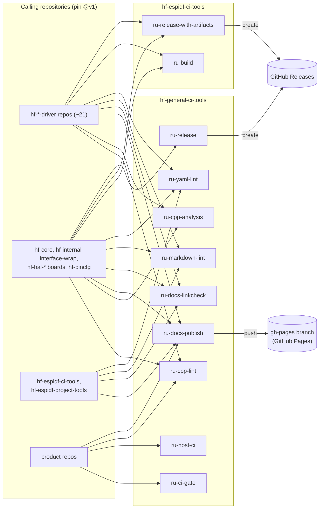

# 🚀 hf-general-ci-tools

Reusable GitHub Actions workflows (`ru-*.yml`) for C/C++ linting and static
analysis, host CMake builds, documentation (Doxygen + Jekyll to GitHub Pages),
link and lint checks, and a single required CI gate. The repositories in the
hardfoc organisation call them; ESP-IDF firmware builds live in the sibling
[hf-espidf-ci-tools](https://github.com/hardfoc/hf-espidf-ci-tools).

[](https://github.com/hardfoc/hf-general-ci-tools/actions/workflows/ci-self.yml)
[](https://github.com/hardfoc/hf-general-ci-tools/actions/workflows/ci-docs-publish.yml)
[](LICENSE)
[](https://hardfoc.github.io/hf-general-ci-tools)

## Contents

- [Architecture](#architecture)
- [Versioning](#versioning)
- [Permissions contract](#permissions-contract)
- [One required check: the CI gate](#one-required-check-the-ci-gate)
- [Workflows: callers and inputs](#workflows-callers-and-inputs)
- [How this repository tests itself](#how-this-repository-tests-itself)

## Architecture



Each workflow is self-contained. It calls only third-party actions, which are
pinned to commit SHAs, and never another workflow of this repository at a
moving ref. Pinning a caller to `@v1` therefore pins everything it runs.

| Workflow | Purpose |
| --- | --- |
| [`ru-ci-gate.yml`](.github/workflows/ru-ci-gate.yml) | One required check that passes only if every job passed ([guide](docs/ru-ci-gate.md)) |
| [`ru-host-ci.yml`](.github/workflows/ru-host-ci.yml) | CMake configure/build/ctest, then clang-tidy 18 and cppcheck on the compile database ([guide](docs/ru-host-ci.md)) |
| [`ru-cpp-lint.yml`](.github/workflows/ru-cpp-lint.yml) | clang-format and clang-tidy through cpp-linter-action ([guide](docs/ru-cpp-lint.md)) |
| [`ru-cpp-analysis.yml`](.github/workflows/ru-cpp-analysis.yml) | cppcheck over source directories ([guide](docs/ru-cpp-analysis.md)) |
| [`ru-docs-publish.yml`](.github/workflows/ru-docs-publish.yml) | Doxygen and Jekyll, versioned deploy to `gh-pages`; PRs build without deploying ([guide](docs/ru-docs-publish.md)) |
| [`ru-docs-linkcheck.yml`](.github/workflows/ru-docs-linkcheck.yml) | lychee link check ([guide](docs/ru-docs-linkcheck.md)) |
| [`ru-markdown-lint.yml`](.github/workflows/ru-markdown-lint.yml) | markdownlint-cli2 ([guide](docs/ru-markdown-lint.md)) |
| [`ru-yaml-lint.yml`](.github/workflows/ru-yaml-lint.yml) | yamllint ([guide](docs/ru-yaml-lint.md)) |
| [`ru-release.yml`](.github/workflows/ru-release.yml) | GitHub Release with generated notes ([guide](docs/ru-release.md)) |

## Versioning

Pin the moving major tag:

```yaml
uses: hardfoc/hf-general-ci-tools/.github/workflows/<workflow>.yml@v1
```

Releases are semver tags (`v1.0.0`, `v1.1.0`, ...). `v1` always points at the
newest `v1.x.y`, so callers get fixes and new optional inputs, never breaking
changes. A removed input, a new required input or a new required permission
only arrives with a new major (`@v2`). Pull requests here are checked for
exactly those changes. See [docs/VERSIONING.md](docs/VERSIONING.md) and
[CHANGELOG.md](CHANGELOG.md).

> After a fix lands here, start a **new** run. "Re-run failed jobs" reuses the
> reusable-workflow revision that the original run resolved.

## Permissions contract

Each workflow declares minimal `permissions` on every job. A called workflow
cannot ask for more than its caller grants. If it does, the run fails before
any job starts (`startup_failure`). Grant **at least** the following, on the
calling job or at the top of the calling workflow. The self-CI fails if a
workflow's job permissions ever differ from this table.

<!-- permissions-table:start -->
| Workflow | Caller must grant | Why |
| --- | --- | --- |
| [`ru-ci-gate.yml`](.github/workflows/ru-ci-gate.yml) | `contents: read` | read the calling workflow to verify `needs` |
| [`ru-cpp-analysis.yml`](.github/workflows/ru-cpp-analysis.yml) | `contents: read` | checkout |
| [`ru-cpp-lint.yml`](.github/workflows/ru-cpp-lint.yml) | `contents: read`, `pull-requests: write` | checkout; cpp-linter thread comments and annotations |
| [`ru-docs-linkcheck.yml`](.github/workflows/ru-docs-linkcheck.yml) | `contents: read` | checkout |
| [`ru-docs-publish.yml`](.github/workflows/ru-docs-publish.yml) | `contents: write` | push to the deployment branch; required on pull requests too, although PRs never deploy |
| [`ru-host-ci.yml`](.github/workflows/ru-host-ci.yml) | `contents: read` | checkout |
| [`ru-markdown-lint.yml`](.github/workflows/ru-markdown-lint.yml) | `contents: read` | checkout |
| [`ru-release.yml`](.github/workflows/ru-release.yml) | `contents: write` | create the GitHub Release |
| [`ru-yaml-lint.yml`](.github/workflows/ru-yaml-lint.yml) | `contents: read` | checkout |
<!-- permissions-table:end -->

## One required check: the CI gate

Put every job of a repository's CI in one workflow, and end it with the gate:

```yaml
  ci-gate:
    name: CI gate
    needs: [build, lint, docs]     # every other job in the workflow
    if: always()                   # a skipped required check counts as passing
    uses: hardfoc/hf-general-ci-tools/.github/workflows/ru-ci-gate.yml@v1
    permissions:
      contents: read
    with:
      needs_json: ${{ toJSON(needs) }}
      allow_skipped: docs          # jobs that may be skipped by design
```

The repository ruleset then requires **only** the check `CI gate / gate`.
GitHub names checks from a called workflow `<calling job> / <called job>`. The
gate fails if any needed job failed or was cancelled, or was skipped without
being listed in `allow_skipped`. It also fails if the calling workflow leaves
a job out of `needs` or drops `if: always()`.

## Workflows: callers and inputs

Each example is the smallest working caller. The inputs tables are generated
from the workflow files (`.github/scripts/gen_readme_inputs.py`), and CI fails
if they go stale.

### ru-ci-gate

See [the CI gate](#one-required-check-the-ci-gate) for the caller.

<!-- inputs:ru-ci-gate.yml:start -->
| Input | Type | Required | Default | Description |
| --- | --- | --- | --- | --- |
| `needs_json` | string | yes | - | The caller's needs context as JSON: the expression toJSON(needs) |
| `allow_skipped` | string | no | `""` | Jobs (ids from `needs`) that may be skipped without failing the gate, separated by commas, spaces or newlines. Every other job must succeed. |
| `verify_needs` | boolean | no | `true` | Read the calling workflow file and fail if a job is missing from the gate's `needs`, or if the gate job lacks `if: always()`. |
<!-- inputs:ru-ci-gate.yml:end -->

### ru-host-ci

```yaml
jobs:
  host:
    uses: hardfoc/hf-general-ci-tools/.github/workflows/ru-host-ci.yml@v1
    permissions:
      contents: read
    with:
      preset: host-debug
      build_dir: build/host-debug          # the preset's binaryDir
      tidy_paths: "^(src|include)/"
```

<!-- inputs:ru-host-ci.yml:start -->
| Input | Type | Required | Default | Description |
| --- | --- | --- | --- | --- |
| `preset` | string | no | `""` | CMake configure preset (from CMakePresets.json in source_dir). Empty: configure with -S source_dir -B build_dir. |
| `source_dir` | string | no | `.` | CMake source directory, relative to the repository root |
| `build_dir` | string | no | `build/host` | Build directory, relative to the repository root. With a preset this must be the preset's binaryDir; compile_commands.json is read from here. |
| `cmake_args` | string | no | `""` | Extra arguments for the configure step (space separated) |
| `build_type` | string | no | `Debug` | CMAKE_BUILD_TYPE when no preset is used |
| `run_tests` | boolean | no | `true` | Run ctest after the build |
| `ctest_args` | string | no | `""` | Extra arguments for ctest (space separated) |
| `tidy_paths` | string | no | `""` | Python regular expression matched (re.search) against each translation unit's path relative to the repository root. Only matching files are given to clang-tidy and cppcheck. Empty: every file in the database. |
| `exclude_paths` | string | no | `(^\|/)(third_party\|external\|vendor\|_deps)/` | Python regular expression; translation units whose relative path matches are never analysed, and findings in matching files are not counted. The build directory is always excluded. |
| `run_clang_tidy` | boolean | no | `true` | Run clang-tidy 18 on the selected files |
| `clang_tidy_config` | string | no | `""` | Path to a .clang-tidy file. Empty: clang-tidy's normal lookup from each source file |
| `run_cppcheck` | boolean | no | `true` | Run cppcheck on the selected files |
| `cppcheck_suppressions` | string | no | `""` | Path to a cppcheck --suppressions-list file (optional) |
| `cppcheck_enable` | string | no | `warning,performance,portability` | cppcheck --enable value |
| `fail_on_findings` | boolean | no | `true` | Fail the job when clang-tidy or cppcheck report findings |
| `apt_packages` | string | no | `""` | Extra apt packages to install before configuring (space separated) |
| `submodules` | string | no | `false` | actions/checkout submodules value: false, true or recursive |
| `runs_on` | string | no | `ubuntu-24.04` | Runner label (Ubuntu 24.04 or newer, for clang-tidy-18 from apt) |
| `artifact_name` | string | no | `host-ci-reports` | Name of the uploaded report artifact |
<!-- inputs:ru-host-ci.yml:end -->

### ru-cpp-lint

```yaml
jobs:
  lint:
    uses: hardfoc/hf-general-ci-tools/.github/workflows/ru-cpp-lint.yml@v1
    permissions:
      contents: read
      pull-requests: write
    with:
      clang_format_config: _config/.clang-format
      clang_tidy_config: _config/.clang-tidy
```

<!-- inputs:ru-cpp-lint.yml:start -->
| Input | Type | Required | Default | Description |
| --- | --- | --- | --- | --- |
| `clang_version` | string | no | `20` | Clang major version |
| `clang_format_config` | string | no | `_config/.clang-format` | Path to clang-format configuration file |
| `clang_tidy_config` | string | no | `_config/.clang-tidy` | Path to clang-tidy configuration file |
| `tidy_checks` | string | no | - | clang-tidy checks (comma-separated glob patterns, use - prefix to disable) |
| `extensions` | string | no | `c,cpp,cc,cxx,h,hpp` | File extensions to check (comma-separated) |
| `ignore` | string | no | `build\|.git` | Files or directories to exclude from linting (pipe-separated) |
| `files_changed_only` | boolean | no | `false` | Only lint files that have been changed in the pull request |
| `lines_changed_only` | boolean | no | `false` | Only inspect lines that have changed in the pull request |
| `step_summary` | boolean | no | `true` | Add a summary of linting results to the workflow step summary |
| `file_annotations` | boolean | no | `true` | Display linting errors and warnings as file annotations in the GitHub UI |
| `thread_comments` | boolean | no | `false` | Post a single, collapsible thread comment in a pull request detailing all linting issues |
<!-- inputs:ru-cpp-lint.yml:end -->

### ru-cpp-analysis

```yaml
jobs:
  cppcheck:
    uses: hardfoc/hf-general-ci-tools/.github/workflows/ru-cpp-analysis.yml@v1
    permissions:
      contents: read
    with:
      paths: "src inc"
```

<!-- inputs:ru-cpp-analysis.yml:start -->
| Input | Type | Required | Default | Description |
| --- | --- | --- | --- | --- |
| `paths` | string | no | `src inc examples` | Dirs to analyze (space-separated) |
| `std` | string | no | `c++17` | C++ standard |
| `strict` | boolean | no | `false` | Fail job if any issues found |
| `exclude` | string | no | `""` | Paths to exclude (space-separated) |
| `enable` | string | no | `warning,style,performance,portability,information` | Checks to enable (comma-separated: all,warning,style,performance, portability,information,unusedFunction,missingInclude) |
| `force` | boolean | no | `false` | Force checking even with incomplete analysis |
| `max_configs` | number | no | `0` | Maximum configs to check (for template-heavy code, 0=unlimited) |
<!-- inputs:ru-cpp-analysis.yml:end -->

### ru-docs-publish

Call it on pull requests as well. They take the PR build path: the whole site
is built and uploaded as an artifact, and nothing is deployed.

```yaml
on:
  push:
    branches: [main]
  pull_request:

jobs:
  docs:
    uses: hardfoc/hf-general-ci-tools/.github/workflows/ru-docs-publish.yml@v1
    permissions:
      contents: write
    with:
      doxygen_config: _config/Doxyfile
      jekyll_enabled: true
      jekyll_source: "."
      jekyll_config: _config/_config.yml
```

#### ru-docs-publish inputs

<!-- inputs:ru-docs-publish.yml:start -->
| Input | Type | Required | Default | Description |
| --- | --- | --- | --- | --- |
| `checkout_recursive` | boolean | no | `false` | Checkout submodules recursively (useful for projects with documentation in submodules) |
| `run_link_check` | boolean | no | `true` | Run documentation link checker |
| `link_check_paths` | string | no | `**/*.md` | Space-separated paths to check for broken links |
| `link_check_config` | string | no | `""` | Path to lychee.toml config file (optional) |
| `verbose` | boolean | no | `false` | Enable verbose output for link checking |
| `yamllint_config` | string | no | `_config/.yamllint` | Path to yamllint configuration file |
| `run_markdown_lint` | boolean | no | `false` | Run markdown linting on documentation files |
| `markdown_lint_paths` | string | no | `**/*.md` | Glob patterns for markdown files to lint |
| `markdown_lint_config` | string | no | `_config/.markdownlint.json` | Path to markdownlint configuration file |
| `run_spell_check` | boolean | no | `false` | Run spell checking on documentation files |
| `spell_check_paths` | string | no | `**/*.md` | Glob patterns for files to spell check |
| `spell_check_config` | string | no | `.cspell.json` | Path to cspell configuration file |
| `deployment_branch` | string | no | `gh-pages` | Branch name for deployment (required for versioned documentation) |
| `deploy_pages` | boolean | no | `true` | Deploy to GitHub Pages. Ignored on pull_request, pull_request_target and merge_group events, which always take the PR build path (build and upload the docs-html artifact, no deploy). |
| `artifact_name` | string | no | `docs-html` | Name of the uploaded site artifact (set it when calling this workflow more than once in one run) |
| `doxygen_config` | string | no | `Doxyfile` | Path to Doxyfile (relative to repo root) - output directory auto-detected from OUTPUT_DIRECTORY and HTML_OUTPUT settings |
| `doxygen_working_directory` | string | no | `.` | Directory to execute Doxygen from (defaults to repository root). Relative paths in the Doxyfile are resolved against this directory. |
| `doxygen_fail_on_warnings` | boolean | no | `false` | Treat Doxygen warnings as errors in CI |
| `jekyll_enabled` | boolean | no | `false` | Enable Jekyll static site generation for enhanced documentation presentation |
| `jekyll_config` | string | no | `_config.yml` | Comma-separated list of Jekyll configuration files (e.g., "_config.yml,_config_prod.yml") |
| `jekyll_source` | string | no | `docs` | Jekyll source directory containing your site files |
| `jekyll_destination` | string | no | `_site` | Jekyll build destination directory for generated site |
| `jekyll_environment` | string | no | `production` | Jekyll environment (development, production, staging) - affects which config files are loaded |
| `jekyll_safe` | boolean | no | `true` | Run in safe mode (disables custom plugins, used by GitHub Pages) - CI Recommended |
| `jekyll_plugins_dir` | string | no | `""` | Comma-separated list of plugin directories (--plugins option) |
| `jekyll_layouts_dir` | string | no | `""` | Layout directory (--layouts option) |
| `jekyll_verbose` | boolean | no | `false` | Enable verbose output during Jekyll build - CI Recommended for debugging |
| `jekyll_strict_front_matter` | boolean | no | `true` | Cause build to fail if there is a YAML syntax error in front matter - CI Recommended |
| `jekyll_drafts` | boolean | no | `false` | Include draft posts in the build (useful for development) |
| `jekyll_future` | boolean | no | `false` | Include future-dated posts in the build |
| `jekyll_unpublished` | boolean | no | `false` | Include unpublished posts in the build |
| `jekyll_incremental` | boolean | no | `false` | Enable incremental builds for faster development (may cause issues in CI) |
| `jekyll_lsi` | boolean | no | `false` | Enable LSI (Latent Semantic Indexing) for related posts |
| `jekyll_limit_posts` | string | no | `""` | Limit the number of posts to parse and publish |
| `jekyll_profile` | boolean | no | `false` | Enable profiling output to show build performance (reduces build time) |
| `jekyll_quiet` | boolean | no | `false` | Suppress normal output during Jekyll build (reduces debugging info) |
| `jekyll_trace` | boolean | no | `false` | Show full backtrace when an error occurs (debug only) |
<!-- inputs:ru-docs-publish.yml:end -->

### ru-docs-linkcheck

```yaml
jobs:
  links:
    uses: hardfoc/hf-general-ci-tools/.github/workflows/ru-docs-linkcheck.yml@v1
    permissions:
      contents: read
    with:
      paths: "docs/**/*.md *.md"
```

<!-- inputs:ru-docs-linkcheck.yml:start -->
| Input | Type | Required | Default | Description |
| --- | --- | --- | --- | --- |
| `checkout_recursive` | boolean | no | `false` | Checkout submodules recursively (useful for projects with documentation in submodules) |
| `paths` | string | no | `docs/** *.md **/docs/**` | Space-separated paths to check for broken links |
| `fail_on_errors` | boolean | no | `true` | Fail the workflow if broken links are found |
| `timeout` | string | no | `10` | Timeout in seconds for each link check |
| `max_retries` | string | no | `3` | Maximum number of retries per request |
| `retry_wait_time` | string | no | `1` | Minimum wait time in seconds between retries |
| `exclude_private` | boolean | no | `true` | Exclude private/internal links |
| `exclude_mail` | boolean | no | `true` | Exclude mailto links |
| `verbose` | boolean | no | `false` | Enable verbose output |
| `config_file` | string | no | `""` | Path to lychee.toml config file (optional) |
<!-- inputs:ru-docs-linkcheck.yml:end -->

### ru-markdown-lint

```yaml
jobs:
  markdown:
    uses: hardfoc/hf-general-ci-tools/.github/workflows/ru-markdown-lint.yml@v1
    permissions:
      contents: read
    with:
      config_file: _config/.markdownlint.json
```

<!-- inputs:ru-markdown-lint.yml:start -->
| Input | Type | Required | Default | Description |
| --- | --- | --- | --- | --- |
| `globs` | string | no | `**/*.md` | Space-separated list of glob patterns to check (default: all markdown files) |
| `config_file` | string | no | `_config/.markdownlint.json` | Path to markdownlint configuration file (default: _config/.markdownlint.json) |
| `exclude_patterns` | string | no | `.git/**,node_modules/**,venv/**,.venv/**,_site/**,**/hf-espidf-project-tools/**` | Comma-separated patterns to exclude from checking |
| `use_docker` | boolean | no | `false` | Use Docker container instead of official action (for more control) |
| `fix` | boolean | no | `false` | Automatically fix fixable issues (equivalent to --fix flag) |
| `separator` | string | no | `""` | Separator to use between glob patterns (default: space) |
<!-- inputs:ru-markdown-lint.yml:end -->

### ru-yaml-lint

```yaml
jobs:
  yaml:
    uses: hardfoc/hf-general-ci-tools/.github/workflows/ru-yaml-lint.yml@v1
    permissions:
      contents: read
    with:
      config_file: _config/.yamllint
```

<!-- inputs:ru-yaml-lint.yml:start -->
| Input | Type | Required | Default | Description |
| --- | --- | --- | --- | --- |
| `paths` | string | no | `**/*.yml,**/*.yaml` | Comma-separated list of paths to check (default: all YAML files) |
| `config_file` | string | no | `_config/.yamllint` | Path to yamllint configuration file (default: _config/.yamllint) |
| `strict_mode` | boolean | no | `false` | Enable strict mode (fail on warnings) |
| `exclude_patterns` | string | no | `.git/**,node_modules/**,venv/**,.venv/**,**/hf-espidf-project-tools/**` | Comma-separated patterns to exclude from checking |
<!-- inputs:ru-yaml-lint.yml:end -->

### ru-release

```yaml
on:
  push:
    tags: ["v*"]

jobs:
  release:
    uses: hardfoc/hf-general-ci-tools/.github/workflows/ru-release.yml@v1
    permissions:
      contents: write
```

<!-- inputs:ru-release.yml:start -->
| Input | Type | Required | Default | Description |
| --- | --- | --- | --- | --- |
| `draft` | boolean | no | `false` | Create as draft release |
| `prerelease` | boolean | no | `false` | Mark as pre-release |
| `tag_name` | string | no | `""` | Tag name for release (defaults to github.ref_name) |
<!-- inputs:ru-release.yml:end -->

## How this repository tests itself

| Workflow | What it checks |
| --- | --- |
| [`ci-self.yml`](.github/workflows/ci-self.yml) | Runs actionlint with shellcheck (pinned, any finding fails). Fails any `run:` block ending in a bare `cond && cmd`. Checks the permissions contract against the table above, the README inputs tables, and breaking changes against the PR base. Runs unit tests for these checks, and runs the CI gate on itself |
| [`ci-docs-publish.yml`](.github/workflows/ci-docs-publish.yml) | Builds this site (Jekyll source `.`) and a fixture site whose source is a subdirectory |
| [`ci-host-ci.yml`](.github/workflows/ci-host-ci.yml) | Runs `ru-host-ci` on a fixture: preset path on clean code must pass; `-S/-B` path with seeded defects must report findings |
| `ci-cpp-lint.yml`, `ci-cpp-analysis.yml`, `ci-docs-linkcheck.yml`, `ci-markdown-lint.yml`, `ci-yaml-lint.yml` | Each runs its workflow on this repository |

Third-party actions are pinned to commit SHAs with a `# vX.Y.Z` comment, and
Dependabot keeps them current. Contributions follow
[CONTRIBUTING.md](CONTRIBUTING.md). Licensed under [GPL v3](LICENSE).
