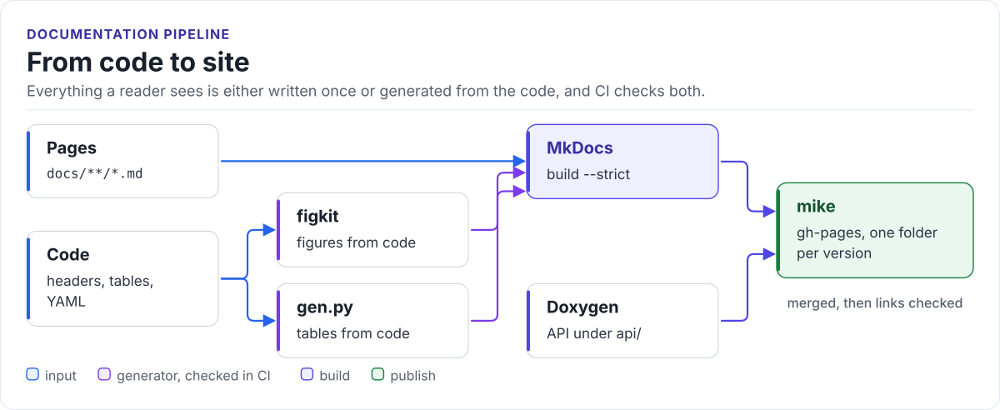

# Figures

<!-- Generated by tools/figkit/build.py from docs/diagrams/figures/*.py. Do not edit by hand. -->

Every figure on this site is drawn by a Python module from facts extracted from the code, so it is rebuilt,
not redrawn, when the code changes. CI runs `python3 tools/figkit/build.py --check` and fails when a
committed figure no longer matches the code. Each figure below lists the files it is drawn from.

## From code to site

<!-- figure: docs-pipeline -->
<picture>
  <source media="(prefers-color-scheme: dark)" srcset="docs-pipeline.dark.svg">
  
</picture>
<!-- /figure -->

Figure module: [`docs/diagrams/figures/docs-pipeline.py`](../../docs/diagrams/figures/docs-pipeline.py)

Drawn from:

- [`mkdocs.yml`](../../mkdocs.yml)
- [`tools/figkit/build.py`](../../tools/figkit/build.py)
- [`tools/docs/gen.py`](../../tools/docs/gen.py)
- [`tools/docs/mkdocs_hooks.py`](../../tools/docs/mkdocs_hooks.py)
